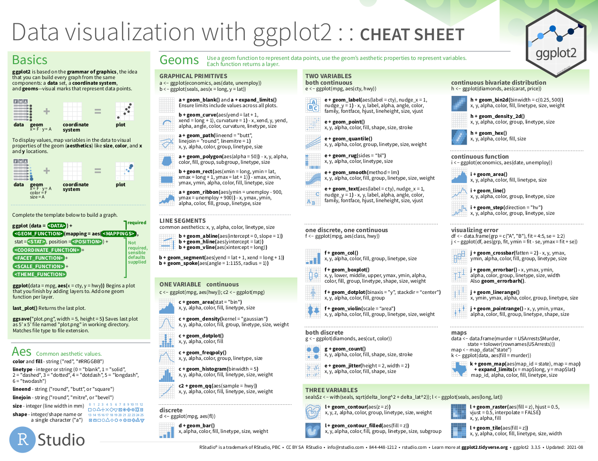
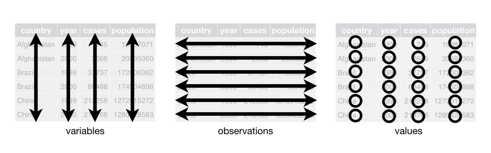
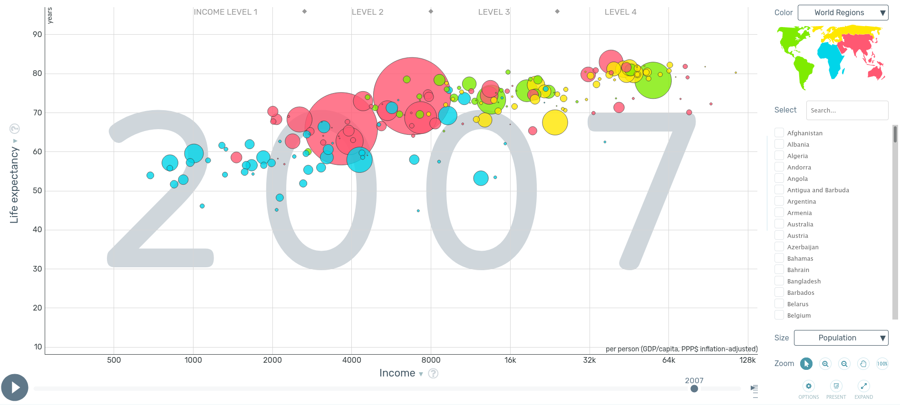
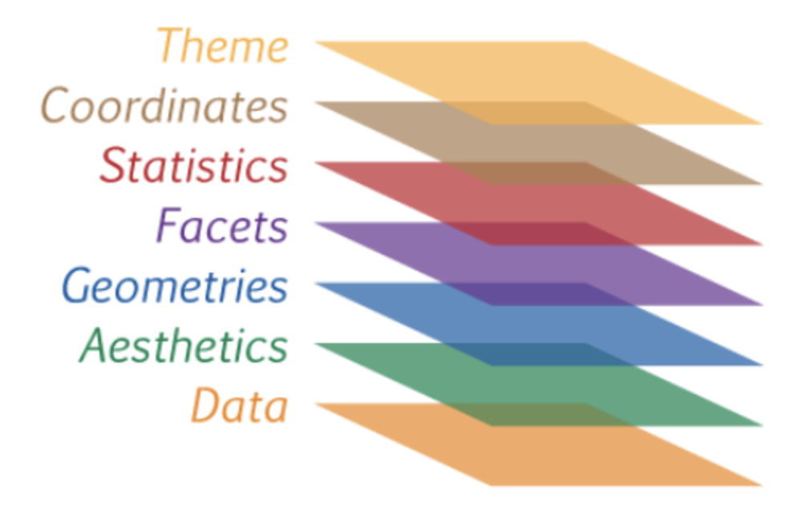
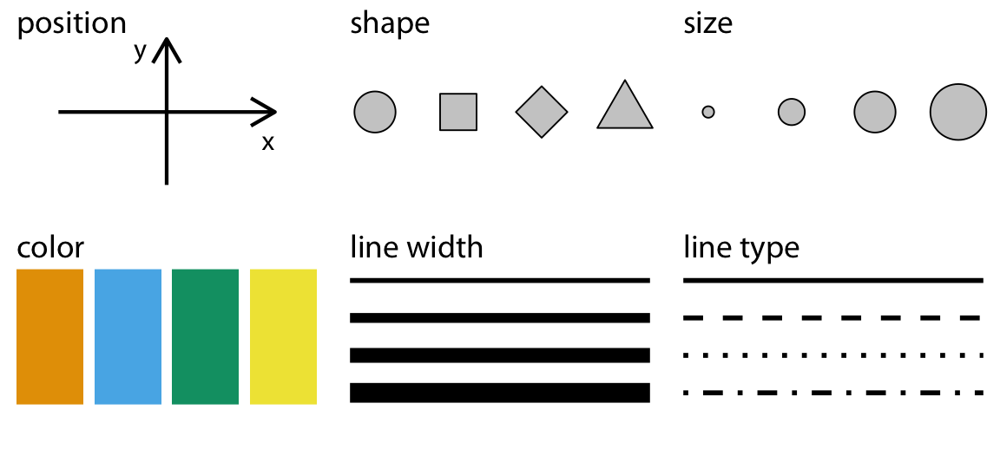
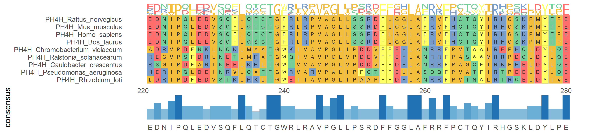

### Verinizi görselleştirin!


:::footer
Kaynak: https://github.com/stephlocke/datasauRus
:::

---

### ggplot paketi

* Oldukça esnek ve güçlü
* Tutarlı (grammar of graphics)
* Aktif olarak geliştiriliyor ve geniş kullanıcı kitlesi
* En başta biraz zor ama getirisi çok

---

### Birçok kaynak mevcut

* [Resmi ggplot2 dokümantasyonu](https://ggplot2.tidyverse.org/reference/)
* [ggplot2 kitabı](https://github.com/hadley/ggplot2-book)
* [Cookbook for R](http://www.cookbook-r.com/Graphs/)
* *R for Data Science* kitabındaki [veri görselleştirme bölümü](https://r4ds.had.co.nz/data-visualisation.html)
* [A ggplot2 Tutorial for Beautiful Plotting in R (C. Scherer)](https://www.cedricscherer.com/2019/08/05/a-ggplot2-tutorial-for-beautiful-plotting-in-r/)
* [Data visualization: a practical introduction (K. Healy)](https://socviz.co/)
* [Fundamentals of data visualization (C. Wilke)](https://clauswilke.com/dataviz/)


---

### Cheatsheet



:::footer
Kaynak: [Rstudio ggplot2 cheatsheet](https://rstudio.github.io/cheatsheets/data-visualization.pdf)
:::

---

### Veri *tidy* olmalı

* Her değişkenin kendi sütunu olmalı
* Her gözlemin kendi satırı olmalı
* Her değerin kendi hücresi olmalı




::: footer
Kaynak: *R for Data Science* kitabı, [Bölüm 12 Tidy Data](https://r4ds.had.co.nz/tidy-data.html)
:::

---

### Kullanılacak paket ve veri

**Gapminder** veri setini kullanacağız

```{r warning=FALSE, message=FALSE}
library(tidyverse)
library(gapminder)
gapminder
```

---

### Amaç

Gapminder [sitesindeki](https://www.gapminder.org/tools/#%24model%24markers%24bubble%24encoding%24frame%24value=2007%3B%3B%3B%3B%3B&chart-type=bubbles&url=v1) bu görsele yakın bir görsel çizebilir miyiz?



---

### ggplot katmanları




**Scales**, *Geometry* ve *Facets* arasında bir katman olarak sayılabilir.
<br>
<br>
<br>


---

### İlk görsel 

```{r}
#| fig-width: 11
gapminder |> 
  ggplot()
```

---

### İkinci görsel / veri katmanı

```{r}
#| fig-width: 11
gapminder |> 
  ggplot(aes(x=gdpPercap, y=lifeExp))
```

Veriyi  x ve y koordinatlarına eşledik ama nasıl gösterileceğini belirtmedik (point, line, box, cirlce, vs.)

---

### Aesthetics (`aes`) 

Değişkenleri (age, distance) grafik elemanlara (eksen, renk) eşler



::: footer
Kaynak: *Fundamentals of Data Visualization*, [Chapter 2 Visualizing Data](https://clauswilke.com/dataviz/aesthetic-mapping.html)
:::

---

### *geom*lar


```{r}
#| fig-width: 11
gapminder |> 
  ggplot(aes(x=gdpPercap, y=lifeExp)) +
  geom_point()
```

::: footer
Tam liste R4DS kitabının ilgili [kısmında](https://ggplot2-book.org/individual-geoms.html) ve [data visualization cheatsheet](https://raw.githubusercontent.com/rstudio/cheatsheets/main/data-visualization.pdf) sitesinde bulunabilir
:::

---

### Soru

* Sizce `geom_bar()` ve `geom_col()` nasıl bir görsel üretir?
* Eğer `geom_lines()` ile çizgi çizmek istersek, veriyi yıla göre mi, ülkeye göre mi gruplamak gerekir?

---

## İşlenmiş veri ggplot'a pipe ile iletilebilir

```{r}
#| fig-width: 11
#| code-line-numbers: "2"
gapminder |> 
  filter(year=="2007") |>
  ggplot(aes(x=gdpPercap, y=lifeExp)) +
  geom_point()
```

---


::: {.callout-note}
O halde, bütün tidyverse fonksiyonları, pipe sayesinde `ggplot` ile birleştirilebilir!
:::

::: {.callout-warning}
Fonksiyonları birleştirmek için `%>%` veya `|>` kullanılırken ggplot katmanlarını birleştirmek için `+` kullanılır
:::

---

### Geom özellikleri

Geomların boyutu, rengi, şekli, genişliği ve saydamlığı (alpha):

* sabit bir değer olarak verilebilir
* ya da verimizdeki bir değişkene eşlenebilir

---

### Tüm noktaların rengini değiştirme

```{r}
#| fig-width: 11
gapminder |> 
  filter(year=="2007") |> 
  ggplot(aes(x=gdpPercap, y=lifeExp)) +
  geom_point(color="red")
```

---

### Rengi bir değişkene eşleme 

```{r}
#| fig-width: 11
gapminder |> 
  filter(year=="2007") |> 
  ggplot(aes(x=gdpPercap, y=lifeExp)) +
  geom_point(aes(color=continent))
```

---

### Renk: eşlemek vs. eşlememek

Eşlemeden (sabit değer)

```{r}
#| eval: false
geom_point(colour = "red")
# colour'a somut bir değer ('red') verilir
```

vs. eşleyerek

```{r}
#| eval: false
geom_point(aes(colour = continent))
# colour bir *değişkeni* eşler (`aes` ile)
```

---

### Daha fazla özelliği eşleme

Rengi kıtaya (`continent`), nokta boyutunu nüfusa (`pop`) eşleyelim

```{r}
#| fig-width: 11
gapminder |> 
  filter(year=="2007") |> 
  ggplot(aes(x=gdpPercap, y=lifeExp, color=continent)) +
  geom_point(aes(size=pop))
```

---

### Eşlenen değerler ölçeklenebilir (*Scales* katmanı) {.smaller}

Ayrık değerlerin renkleri `scale_color_discrete`, `scale_color_manual` (ve daha birçok renk paleti paketi) ile düzenlenebilir

Sürekli verilerin renkleri `scale_color_continuous`, `scale_color_gradient` (ve daha birçok renk paleti paketi) ile denetlenir

`continent` ayrık, `lifeExp` ise sürekli bir değişkendir.

Rengi `continent`'e eşleyip renkleri değiştirelim.

---

### Ayrık eşleme ölçeği

```{r}
#| fig-width: 11
gapminder |> 
  filter(year=="2007") |> 
  ggplot(aes(x=gdpPercap, y=lifeExp, color=continent)) +
  geom_point() +
  scale_color_manual(values = c("orange", "blue","red","green","black"))
```
---

### Sürekli eşleme ölçeği

Şimdi rengi `lifeExp`'e eşleyip renkleri değiştirelim.

```{r}
#| fig-width: 11
gapminder |> 
  filter(year=="2007") |> 
  ggplot(aes(x=gdpPercap, y=lifeExp, color=lifeExp)) +
  geom_point() +
  scale_color_gradient(low="blue",high = "red")
```
---

### X veya Y koordinatlarının ölçeklenmesi {.smaller}

Pratik bir kural: değer aralığı çok genişse ve büyük sayılar sonuçları görmeyi engelliyorsa logaritmik ölçek kullanın. Ya `mutate` ile yeni bir sütun üretebilir ya da ölçekleme fonksiyonlarını kullanabilirsiniz. (*scale_* yazıp Tab tuşuna basarak fonksiyonları listeleyebilirsiniz). Aşağıda *gdpPercap* verisini ölçeklemek için `scale_x_log10()` kullanıldı.

```{r}
#| echo: false
#| fig-width: 11
gapminder |> 
  filter(year=="2007") |> 
  ggplot(aes(x=gdpPercap, y=lifeExp, color=continent)) +
  geom_point(aes(size=pop)) +
  scale_x_log10()
```

---

### Soru

* Bir önceki görseli mutate kullanarak ( örn. `mutate(lifelog=log(lifeExp))`) çizerseniz, Y eksenindeki sayılar nasıl görünür?

---

### Birden fazla `geom_point` katmanı

`ggplot` çok güçlü ve esnektir. Farklı geomları birleştirerek özgün grafikler üretebilirsiniz. Nüfusu 100 milyondan fazla olan ülkeleri renklendirip vurgulayalım.

Bu ülkeleri içeren ayrı bir veri çerçevesi oluşturup bu ülkeleri ayrı bir `geom_point` katmanı olarak çizeceğiz.

```{r}
populated <- gapminder |> filter(year=="2007") |> filter(pop > 100000000)
```

---

```{r}
#| fig-width: 11
#| code-line-numbers: "5"
gapminder |> 
  filter(year=="2007") |> 
  ggplot(aes(x=gdpPercap, y=lifeExp)) +
  geom_point() +
  geom_point(data=populated, color="red", size=3)
```

---

### Egzersiz

Siyah noktaları `size=3`, kırmızı noktaları `size=1` şeklinde çizdirin. Katmanları ayırt edebiliyor musunuz?

```{webr}
#| label: iki-katman
library(dplyr)
library(ggplot2)
library(gapminder)

populated <- gapminder |> filter(year=="2007") |> filter(pop > 100000000)

gapminder
```

---

### Facet katmanı

```{r}
#| fig-width: 11
gapminder |> 
  filter(year=="2007") |> 
  ggplot(aes(x=gdpPercap, y=lifeExp)) +
  geom_point() +
  facet_wrap(~continent)  # her kıta için ayrı grafikler
```

---

### Sorular

* x ve y eksenleri için varsayılan (ve doğru) limitler "not free"dir. "free_x", "free_y" veya her ikisi birlikte olursa ne olur?
* Yaşam beklentisi ekseninin 0'dan (en küçük değerden değil) başlamasını nasıl sağlayabiliriz?

```{webr}
#| label: facet-soru

gapminder |> 
  filter(year=="2007") |> 
  ggplot(aes(x=gdpPercap, y=lifeExp)) +
  geom_point() +
  facet_wrap(~continent, scales=" ")
```

---

### İstatistiksel özet katmanı

```{r}
#| fig-width: 11
gapminder |> 
  filter(year=="2007") |> 
  ggplot(aes(x=gdpPercap, y=lifeExp)) +
  geom_point() +
  geom_smooth() +
  facet_wrap(~continent) 
```

---

### Tema katmanı

Grafiğinizin neredeyse tüm özelliklerini `theme()` fonksiyonuyla özelleştirebilirsiniz. Aynı anda birden çok özelliği değiştirerek grafiğin görünümünü değiştiren `theme_*` fonksiyonları da vardır.

Grafiğimize `theme_classic()` uygulayalım (sonuç bir sonraki slaytta).


```{r}
#| output-location: slide
#| fig-width: 11
gapminder |> 
  filter(year=="2007") |> 
  ggplot(aes(x=gdpPercap, y=lifeExp, color=continent)) +
  geom_point(aes(size=pop)) +
  scale_x_log10() +
  theme_classic()
```

---

### Tema paketleri

Popüler kaynakların temalarını uygulamak için kullanabileceğiniz birçok tema paketi vardır. Tek satır kodla grafiğinize *The Economist* temasını uygulayalım

```{r}
#| output-location: slide
#| fig-width: 11
library(ggthemes)

gapminder |> 
  filter(year=="2007") |> 
  ggplot(aes(x=gdpPercap, y=lifeExp, color=continent)) +
  geom_point(aes(size=pop)) +
  scale_x_log10() +
  theme_economist()     # ggthemes paketi gerektirir
```


---

### Başlıklar {.smaller}

`labs()` fonksiyonu başlık ve alt başlık eklemek, X ve Y eksen etiketlerini değiştirmek için kullanılabilir. Aşağıda grafiğe şu katmanı ekledik

```{.r}
labs(x="GDP Per Capita (USD, Log10)", y="Life Expectancy (years)", 
       title="Wealth vs. Life Expectancy", 
       subtitle="Source: Gapminder (range: 1952-2007)")
```

```{r}
#| fig-width: 11
#| echo: false
gapminder |> 
  filter(year=="2007") |> 
  ggplot(aes(x=gdpPercap, y=lifeExp, color=continent)) +
  geom_point(aes(size=pop)) +
  scale_x_log10() +
  labs(x="GDP Per Capita (USD, Log10)", y="Life Expectancy (years)", 
       title="Wealth vs. Life Expectancy", 
       subtitle="Source: Gapminder (range: 1952-2007)") +
  theme_minimal()
```

---

### İnteraktif HTML çıktısı {.smaller}

Çıktınıza HTML uyumlu grafik/tablolar ekleyebilecek birçok paket vardır. Aşağıdaki kod `plotly` paketiyle etkileşimli bir grafik üretir. Sonuç için bir sonraki slayta bakın.

Üzerine gelerek (hover) inceleyebilir, yakınlaşıp uzaklaşabilir ve bölgeler seçebilirsiniz.

```{r}
#| output-location: slide
#| fig-width: 10.5
#| fig-height: 6.2
library(plotly)

gap_plot <- gapminder |> 
  filter(year=="2007") |> 
  ggplot(aes(x=gdpPercap, y=lifeExp, color=continent)) +
  geom_point(aes(size=pop)) +
  scale_x_log10() +
  theme_minimal()

# width/height pinlenmezse plotly her slayt geçişinde konteyneri yeniden ölçüp
# küçülür (revealjs transform'u ölçeklenmiş boyutu geri besler)
ggplotly(gap_plot, width = 1008, height = 595)
```

---

### ggplot görselleri birer nesnedir

Grafikleri bir nesneye (programlama terimi olan object=nesne) atayıp sonra yeniden kullanabilirsiniz. Var olan bir grafiğe katman da ekleyebilirsiniz. Bir grafik oluşturup onunla farklı temaları deneyelim.

```{r}
baseplot <- gapminder |> 
  filter(year=="2007") |> 
  ggplot(aes(x=gdpPercap, y=lifeExp, color=continent)) +
  geom_point(aes(size=pop)) +
  scale_x_log10()
```

---

### ggplot görselleri birer nesnedir

:::: columns
::: column

```{r}
baseplot + theme_dark()
```
:::

::: column
```{r}
baseplot + theme_linedraw()
```
:::
::::

Grafiklerin nesne olması, bağımsız grafiklerden bileşik figürler oluşturmaya da olanak sağlar. [patchwork](https://patchwork.data-imaginist.com/#basic-example) ve [cowplot](https://wilkelab.org/cowplot/articles/introduction.html#arranging-plots-into-a-grid) paketlerine göz atın.

---

### Görselleri kaydetme

`ggsave()` fonksiyonu ürettiğiniz grafikleri kaydetmek için kullanılır. Grafikleri PNG, PDF, SVG formatlarında kaydedebilir. Yüksek kalite/çözünürlüklü görseller için görüntünün çözünürlüğü ve boyutu ayarlanabilir.

```{r}
#| eval: false
newplot <- baseplot + theme_classic()  
  
ggsave(newplot, filename="gpd-health.png", dpi = 200, width = 6, height = 6)
```

## Özelleşmiş bir görsel

Türkiye'nin yıllara göre değişimini gösteren, OECD ortalamasını yatay çizgi olarak ekleyen ve The Economist temasını kullanan özel bir grafik çizelim. Üstüne bindireceğimiz veriyi hazırlayalım:

```{r}
milli <- gapminder |> filter(country=="Turkey")
etiket <- milli |> filter(year==1982)
oecd_data <- tibble(country="oecd",year=2007,life_mean=81)
```

##

```{r}
#| output-location: slide
#| fig-width: 12
#| fig-height: 8

gapminder |>
  filter(year=="2007") |>
  ggplot(aes(x=gdpPercap, y=lifeExp, alpha=year)) + 
  geom_smooth() +
  geom_point() + 
  scale_x_log10() +
  geom_point(data=milli, color="red") +
  geom_hline(data=oecd_data, 
             aes(yintercept=life_mean), 
             color="gray", 
             linetype="dashed") +
  geom_text(data=etiket, aes(label=country)) +
  facet_wrap(~continent) + 
  ylim(0,100) + 
  theme_economist()
```

## Galeriler {.smaller}

Github'daki [awesome-ggplot2](https://github.com/erikgahner/awesome-ggplot2) reposu kapsamlı bir kaynak listesidir

[R Graph Gallery](https://r-graph-gallery.com/) kategorilere ayrılmış halde mümkün grafikleri gösterir

`ggplot` oldukça esnek bu yüzden çok özelleşmiş grafikler hazırlamak için kullanılabilir. Aşağıdaki kullanıcılar ggplot ile oldukça güzel grafikler hazırlamışlar (Bazı kullanıcılar için ayrı klasörlere bakmanız gerekebilir)

* Cédric Scherer ggplot ile profesyonel düzeyde grafikler yapıyor. [Galerisine](https://github.com/z3tt/TidyTuesday) göz atın (R kodu için [ayrı klasörlere](https://github.com/z3tt/TidyTuesday/tree/main/plots) bakın) Bu tasarımcı tarafından çizilen kahve puanlamasına dair grafiğin detayları için [kahve](coffee.qmd) sayfasını ziyaret ediniz.

* Tanya Shapiro [https://github.com/tashapiro/TidyTuesday](https://github.com/tashapiro/TidyTuesday)
* Ryan Hart [https://github.com/curatedmess/TidyTuesday](https://github.com/curatedmess/TidyTuesday)
* Christophe Nicault [https://github.com/cnicault/tidytuesday](https://github.com/cnicault/tidytuesday)
* Georgios Karamanis [https://github.com/gkaramanis/tidytuesday](https://github.com/gkaramanis/tidytuesday)


## Biyoloji ve biyoinformatik ile ilgili ggplot paketleri {.segue}

## ggbio


:::footer
Kaynak: [ggbio sitesi](https://lawremi.github.io/ggbio/)
:::

## ggenomes


:::footer
Kaynak: [gggenomes sitesi](https://thackl.github.io/gggenomes/)  Bu paket, `geom_seq()`, `geom_gene()` gibi katmanlar kullanır
:::

## ggtrees / ggtreeextra {background-image="https://yulab-smu.top/treedata-book/treedata_files/figure-html/HMPplot-1.png" background-size=contain}

:::footer
[Kaynak](https://yulab-smu.top/treedata-book/chapter4.html)
:::

## ggmsa




:::footer
[Kaynak](https://yulab-smu.top/ggmsa/)
:::


