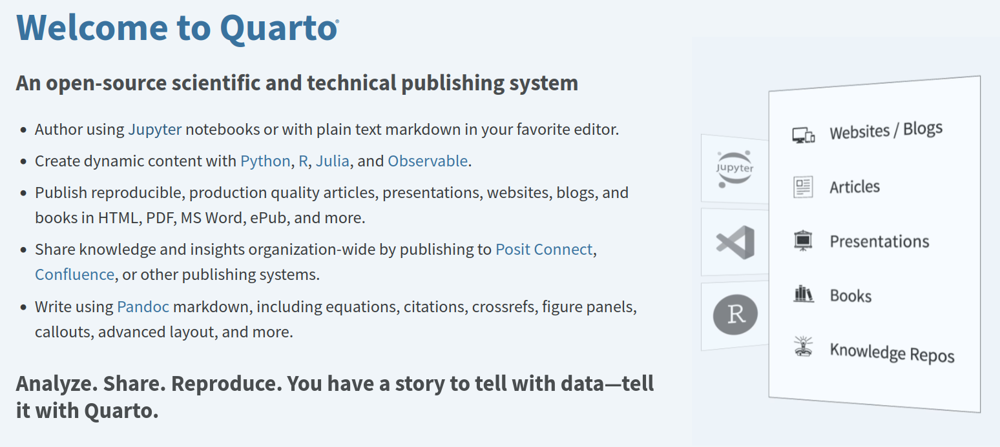
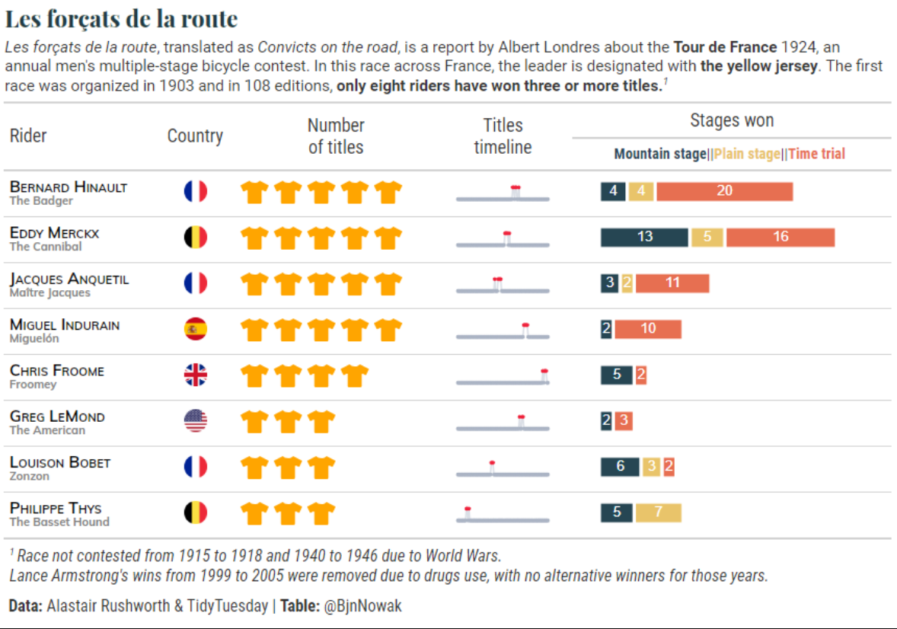

## Rapor yazmak: neden zor?

Bir analiz biter, sonra **rapor** başlar.


Veri her güncelleniyor: yeni ölçüm, yeni sürüm, yeni filtre.
Elle kopyaladığınız figürler sessizce **eski** kalır — ve rapor artık yanlış.

::: {.callout-tip}
## Çözüm: raporu elle yazmayın
Metni, kodu ve çıktıyı **tek bir dosyada** tutun; dosyayı "derleyin".
Veri değişince raporu yeniden üretirsiniz.
:::

## İletişim

::: {.columns}
::: {.column width="30%"}
> What good is an image/analysis/result if you are unable to communicate
:::
::: {.column width="70%"}

:::
:::

:::footer
[Kaynak](https://imgflip.com/memetemplate/320562108/What-good-is-a-phone-call-if-you-are-unable-to-speak)
:::

## Quarto: tek dosyada metin + kod + çıktı


`ders7.qmd` → HTML / PDF / Word / sunum / poster

- **Markdown**: düz metin — okunabilir, sürüm kontrolünde rahat
- **Kod bloğu**: R kodu, belge içinde, normal R komutu gibi
- **Çıktı**: render sırasında otomatik üretilir, elle kopyalanmaz

:::footer
[Kaynak](https://quarto.org/docs/get-started/)
:::

## Quarto (RMarkdown'ın yeri)



::: {.callout-tip}
**İpucu.** RMarkdown hâlâ aktif olarak kullanılıyor, ama lütfen **Quarto** kullanın.
:::

## Nasıl çalışır?


İki aşama var:

1. **knitr** — R kodunu çalıştırır, çıktıları araya yerleştirir → ara `.md`
2. **pandoc** — o `.md` dosyasını istediğiniz biçime çevirir → HTML, PDF, DOCX…

:::footer
[Kaynak](https://quarto.org/docs/computations/r.html)
:::

## Tek kaynak, çok çıktı


```bash
quarto render ders7.qmd                 # HTML (varsayılan)
quarto render ders7.qmd --to pdf        # PDF  (LaTeX gerekir: TinyTeX)
quarto render ders7.qmd --to docx       # Word
quarto render ders7.qmd --to revealjs   # sunum
```

Aynı analiz, aynı metin — farklı okurlar için farklı biçim.

## Markdown: metin + biçim


- Yazarken "**kalın**" yazarsınız, ekranda *kalın* görünür
- Kod yazarkin `` `airquality` `` gibi ters tırnak kullanırsınız
- Başlık `#`, liste `-`, bağlantı `[metin](url)`

:::footer
[Kaynak](https://www.markdownguide.org/basic-syntax/)
:::

## .qmd: düz metin dosyası

Quarto belgesi, farklı biçimlere derlenebilen sıradan bir **düz metin** dosyadır:


RStudio'da açılmış bir `.qmd`: üstte YAML, altında metin ve kod blokları.

## ... HTML

Aynı dosyayı derleyince (Render) tarayıcıda açılan bir HTML rapor olur:


## Sıra sizde

İlk Quarto belgemizi oluşturup derleyelim.


::: {.callout-note}
**Not.** `quarto`, rstudio.cloud projesinde kurulu geliyor. Kendi bilgisayarınızdaki RStudio'yu kullanıyorsanız önce [quarto'yu kurun](https://quarto.org/docs/get-started/).
:::

## Belgeye başlık verin (bu, **dosya adı** değil!)


## Dosya **Untitled** olarak açıldı; şimdi kaydedelim


## Artık belgeyi derleyebiliriz (Render)


::: {.callout-tip}
**İpucu.** İlk derlemede Console'a `install.packages("rmarkdown")` yazarak rmarkdown paketini kurmanız istenebilir.
:::

## Kod bloğu anatomisi


```{r}
#| eval: false
#| label: fig-blok
#| fig-cap: "Aylık ortalama ozon seviyesi"
#| fig-width: 8
#| fig-height: 4

library(ggplot2)
ozon <- aggregate(Ozone ~ Month, airquality, mean, na.rm = TRUE)
ggplot(ozon, aes(Month, Ozone)) +
  geom_line(color = "#222B57", linewidth = 0.9) +
  scale_x_continuous(breaks = 5:9, labels = c("May", "Haz", "Tem", "Ağu", "Eyl")) +
  labs(x = "Ay", y = "Ozon (ppb)", title = "Ozon mevsimsel değişimi") +
  theme_minimal(base_size = 14)
```

## Chunk seçenekleri

| Seçenek | Ne yapar | Ne zaman |
|---|---|---|
| `echo: false` | Kodu gizler | Rapor gövdesinde |
| `eval: false` | Kodu çalıştırmaz | Kurulum gereken bloklarda |
| `message: false` | Mesajları gizler | `library()` çağrılarında |
| `warning: false` | Uyarıları gizler | Gürültülü analizlerde |
| `include: false` | Çıktıyı belgeye koymaz | Yardımcı hesaplamalar |
| `fig-cap`, `label` | Başlık ve kimlik | Çapraz referans için |
| `fig-width`, `fig-height` | Şekil boyutu (inç) | Slayda yerleşim ayarı |

Seçenekler `#|` ile (chunk içinde) ya da YAML `execute:` bloğunda yazılır.
`cache: true` bir sonraki slaytta.

## Kodu gizlemek: `echo`

::: {.columns}
::: {.column width="48%"}
`echo: false` — sadece sonuç

```{r}
#| echo: false
mean(airquality$Ozone, na.rm = TRUE)
```
:::
::: {.column width="48%"}
`echo: true` — kod + sonuç

```{r}
#| echo: true
mean(airquality$Ozone, na.rm = TRUE)
```
:::
:::

::: {.callout-important}
## Kural
**Rapor** kodu gizler (`echo: false`), **ders/sunum** kodu gösterir (`echo: true`).
Aynı `.qmd`yi farklı çıktılara dönüştürürken bu ayrım önemlidir.
:::

## Inline kod: sayıyı yazma, hesaplat

Metin içine doğrudan R kodu yazabilirsiniz:

Veri setinde `r nrow(airquality)` gözlem, ortalama ozon `r round(mean(airquality$Ozon, na.rm = TRUE), 1)` ppb.

Render sırasında hesaplanır ve **metne gömülür**.

::: {.callout-warning}
## Neden önemli?
Raporda "veride 153 satır vardı" yazıp sonra veri değişirse sayı yanlış kalır.
Inline kod sayıyı her derlemede günceller.
:::

## Inline kod: kaynak ve sonuç

Belgeye şu satırı yazarsınız:

```
`mtcars` verisinde `r knitr::inline_expr("nrow(mtcars)")` gözlem vardır. Aşağıdaki tablo ortalama
şehir ve otoyol tüketimini marka ve silindir sayısına göre gösterir.
```

Derleme sonucu ekranda şöyle görünür:

`mtcars` verisinde `r nrow(mtcars)` gözlem vardır. Aşağıdaki tablo ortalama
şehir ve otoyol tüketimini marka ve silindir sayısına göre gösterir.

::: {.callout-tip}
**İpucu.** Üstteki satır kaynak, alttakini ise Quarto derleme sırasında hesaplayıp yazdı.
:::

## Şekil üretmek

```
#| label: fig-ozon
#| fig-cap: "Aylık ortalama ozon seviyesi (airquality, 1973)"
#| fig-width: 8
#| fig-height: 4

library(ggplot2)
ozon <- aggregate(Ozone ~ Month, airquality, mean, na.rm = TRUE)
ggplot(ozon, aes(Month, Ozone)) +
  geom_line(color = "#222B57", linewidth = 0.9) +
  scale_x_continuous(breaks = 5:9, labels = c("May", "Haz", "Tem", "Ağu", "Eyl")) +
  labs(x = "Ay", y = "Ozon (ppb)", title = "Ozon mevsimsel değişimi") +
  theme_minimal(base_size = 14)
```

##


```{r}
#| label: fig-ozon
#| fig-cap: "Aylık ortalama ozon seviyesi (airquality, 1973)"
#| fig-width: 8
#| fig-height: 4

library(ggplot2)
ozon <- aggregate(Ozone ~ Month, airquality, mean, na.rm = TRUE)
ggplot(ozon, aes(Month, Ozone)) +
  geom_line(color = "#222B57", linewidth = 0.9) +
  scale_x_continuous(breaks = 5:9, labels = c("May", "Haz", "Tem", "Ağu", "Eyl")) +
  labs(x = "Ay", y = "Ozon (ppb)", title = "Ozon mevsimsel değişimi") +
  theme_minimal(base_size = 14)
```

## Çapraz referans

Şekle metinden bakın: @fig-ozon

| Ay | Ortalama ozon (ppb) |
|---|---|
| Mayıs | 23.6 |
| Temmuz | 59.1 |
| Eylül | 31.4 |

Table: Aylık ortalama ozon seviyesi (airquality) {#tbl-ozon}

Metinden tabloya bakın: @tbl-ozon

::: {.callout-tip}
## Numaralar otomatik
Şekil/tablo numarası elle yazılmaz; metin değişince güncellenir.
Yeni bir şekil eklerseniz numaralar kendiliğinden kayar. Bu slaytta, `@fig-ozon` ve `@tbl-ozon` ifadeleri Şekil 1 ve Tablo 1 olarak gösterilmiştir. 
:::

## Tablolar: `knitr::kable`

```
#| label: tbl-kable
#| echo: false
library(knitr)
ozon <- aggregate(Ozone ~ Month, data = airquality, FUN = mean, na.rm = TRUE)
names(ozon) <- c("Ay", "Ortalama ozon (ppb)")
kable(ozon, caption = "Aylık ortalama ozon seviyesi", align = "l")
```

- `kable()` — hızlı, bağımlılıksız, pandoc uyumlu tablo
- `gt` paketi — biçimlendirilmiş, "yayın kalitesinde" tablolar
- Raporun *tablo* bölümü, `knitr::kable` + `caption` ile hazırlanır
- Bir sonraki slaytta bu kodun yorumlanmış halini görebilirsiniz. Otomatik olarak "Tablo 2" olarak numaralandırılmıştır

:::footer
[Kaynak](https://yihui.org/knitr/)
:::

##

```{r}
#| label: tbl-kable
#| echo: false
library(knitr)
ozon <- aggregate(Ozone ~ Month, data = airquality, FUN = mean, na.rm = TRUE)
names(ozon) <- c("Ay", "Ortalama ozon (ppb)")
kable(ozon, caption = "Aylık ortalama ozon seviyesi", align = "l")
```

## gt tablo örneği 1



:::footer
[Kaynak](https://bjnnowak.netlify.app/2021/10/04/r-beautiful-tables-with-gt-and-gtextras/)
:::

## gt tablo örneği 2


:::footer
[Kaynak](https://jack-davison.quarto.pub/gt-openair/)
:::

## YAML başlığı: belgenin ayarları

```yaml
---
title: "Quarto ile Raporlama"       # belge başlığı
author: "Alper Yılmaz"
date: 2026-11-09
format:
  html:
    toc: true                     # içindekiler
    number-sections: true        # bölüm numaraları
    code-fold: show               # kodu katlanabilir yap
    df-print: kable               # veri tabloları
    theme: cosmo
execute:
  echo: true
  cache: true
---
```

YAML **belgenin kimlik kartıdır**: başlık, yazar, çıktı biçimi, çalıştırma ayarları.

:::footer
[Kaynak](https://quarto.org/docs/reference/)
:::

## Hangi çıktı?

| Biçim | Ne zaman | Not |
|---|---|---|
| `html` | Rapor, ödev, paylaşım | Varsayılan; tarayıcıda açılır |
| `pdf` | Makale, teslim | LaTeX gerekir (TinyTeX) |
| `docx` | Danışmana/arkadaşa gönderim | Word'de düzeltilebilir |
| `revealjs` | Sunum | Sizin bu derste kullandığınız |
| `poster` | Poster | Şablon gerekir (aşağıya bakın) |
| `website` | Site | `_quarto.yml` ile klasör halinde |

Biçimi YAML'de seçersiniz ya da komut satırından `--to` ile değiştirirsiniz.

## HTML raporunu ayarlamak

```yaml
format:
  html:
    toc: true              # sol tarafta içindekiler
    number-sections: true # 1. Giriş, 2. Yöntem, 3. Sonuç
    code-fold: show       # kod katlanır, tıklanınca açılır
    code-summary: "Kodu göster"
    df-print: kable        # veri tabloları kable biçiminde
    embed-resources: true # tek dosya HTML (paylaşım için)
    theme: cosmo
    fontsize: 11
```

::: {.callout-note}
## Aynı içerik, iki kişi
`format: html` yazan öğrenci tarayıcıda okur; `format: pdf` yazan aynı dosyayı makale
biçiminde teslim eder. Analiz kodu tek yerde kalır.
:::

## Zengin içerik: callout

::: {.callout-note}
**Not.** Bilgilendirme cümlesi.
:::
::: {.callout-tip}
**İpucu.** Öneri, kısa yol.
:::
::: {.callout-warning}
**Uyarı.** Dikkat edilmesi gereken durum.
:::

Callout'lar "kutu" değil, okuma rehberidir: **5 tip** (note, tip, warning, caution, important).

## Sekmeler ve sütunlar

::: {.panel-tabset}

### Veri
```{r}
#| echo: false
str(airquality)
```

### Özet
```{r}
#| echo: false
summary(airquality$Ozone)
```

:::

::: {.columns}
::: {.column width="50%"}
**Sütun 1** — yöntem
:::
::: {.column width="50%"}
**Sütun 2** — sonuç
:::
:::

## Kaynakça ve atıf

```yaml
bibliography: references.bib
```

Metinde: `[@wickham2022]` yazdığınızda [@wickham2022] şeklinde atıfa çevrilir.

Raporun sonuna Quarto, kaynakçayı otomatik ekler.
Biyoenformatikte atıf kültürü önemlidir — veri ve yöntem kaynakları da listelenmelidir.

:::footer
[Kaynak](https://quarto.org/docs/citations/)
:::

## Projenin yapısı


- `index.qmd` → ders takvimi (site girişi)
- `ders-*.qmd` → her biri bir sunum
- `data/` → veri (CSV/TSV) — **sürüm kontrolüne girer**
- `images/` → görseller ve diyagramlar
- `docs/` → render çıktısı: **otomatik oluşur, elle düzenlenmez**

:::footer
[Kaynak](https://quarto.org/docs/projects/)
:::

## Raporu üretmek


```bash
quarto render index.qmd        # tüm siteyi üret
quarto preview                 # canlı önizleme (localhost:4200)
```

RStudio'da: **Render** butonu (`Ctrl+Shift+K`) — önizlemeyi açıp kapanır.

## `cache` ve `freeze`


- `cache: true` → **chunk** düzeyinde: sadece değişen blok yeniden çalışır
- `freeze: auto` → **belge** düzeyinde: HTML'in tamamı saklanır, R hiç çalışmaz

::: {.callout-warning}
## Dikkat
`freeze` kullanırsanız veri değişse bile eski çıktıyı görürsünüz.
Ödevde `freeze` kullanmayın; sadece `cache` kullanın.
:::

## Parametreler: aynı analiz, farklı ayarlar


```yaml
params:
  quarter: Q1
  yil: 2024
```

```bash
quarto render analiz.qmd --execute-param quarter="Q1"
quarto render analiz.qmd --execute-param quarter="Q2"
quarto render analiz.qmd --execute-param quarter="Q3"
quarto render analiz.qmd --execute-param quarter="Q4"
```

Parametreler **YAML başlığında** tanımlanır, komut satırından değiştirilir:
aynı analiz kodunu farklı veri aralıklarıyla çalıştırabilirsiniz.

## Rapor anatomisi


Raporun omurgası sabittir; **poster** de aynı omurganın kısaltılmışıdır.

## Poster


- A0 dikey: 3 sütun, üstte başlık, altta kaynakça
- **Tek mesaj**, **tek ana görsel** — poster bir rapor değil, bir özet
- İçerik aynı Quarto dosyasından üretilir:

```bash
quarto use template bbucior/docposter   # poster şablonunu kurar
quarto render poster.qmd                 # posterı üretir
```

## Poster: adım adım

- posit.cloud'a girin **ya da** kendi bilgisayarınızda RStudio'yu açın
- posit.cloud'da yeni bir proje başlatın
- Terminal'de şu komutu çalıştırın: `quarto use template bbucior/docposter`
- Ardından şu cevapları verin:
  - Do you trust: **yes**
  - Subdirectory: **yes**
  - Name: *istediğiniz ad*
  - Continue: **yes**
- Bazı paketleri kurabilir/güncelleyebilir (yalnızca ilk seferde)
- Sonra klasöre gidin, verdiğiniz adla `.qmd` dosyasını açın
- Belgeyi **Render** edin (ilk derlemede paket kurulabilir)
- Oluşan html dosyasını **Web Browser**'da açın

## Sık hatalar

::: {.columns}
::: {.column width="50%"}
**Veri / yol hataları**

- Veriyi mutlak yolla (`/Users/...`) çağırmak → başkasında çalışmaz
- `read_csv("veri.csv")` → çalışma klasörü farklıysa hata
- Dosya adında Türkçe karakter / boşluk
- Şekli PNG yerine kaybetmeyen formatta (SVG/PDF) saklamamak
:::
::: {.column width="50%"}
**Quarto hataları**

- `freeze` açık kalmış → eski çıktı
- `cache` açık kalmış → değişen kod eski sonucu gösteriyor
- `fig-cap` unutulmuş → şekilsiz rapor
- Çapraz referans yerine elle "Şekil 1" yazmak
- Render edilen `docs/` dosyasını elle düzenlemek
:::
:::

## Sıra Sizde

**Kendi analizinizi bir Quarto raporuna dönüştürün.**

- [ ] Verinizi `data/` altına koyun, `read_csv()` ile okuyun
- [ ] En az **1 tablo** (özet) ve **2 şekil** üretin
- [ ] Şekil/tablolara **başlık (caption)** ve **çapraz referans** ekleyin
- [ ] Rapor bölümleri: Giriş → Yöntem → Sonuçlar
- [ ] `quarto render` ile **HTML** ve **PDF** üretin
- [ ] Poster taslağı: aynı `.qmd` dosyasından 3 sütunlu poster


## Kaynaklar

- Quarto rehberi: [quarto.org/docs](https://quarto.org/docs)
- Raporlama: [quarto.org/docs/computations/r](https://quarto.org/docs/computations/r.html)
- Biçimler: [quarto.org/docs/formats](https://quarto.org/docs/formats.html)
- Atıf: [quarto.org/docs/citations](https://quarto.org/docs/citations.html)
- Slaytlar: [rstudio.github.io/quarto](https://rstudio.github.io/quarto/)
- Markdown: [markdownguide.org](https://www.markdownguide.org/)

:::footer
[Kaynak](https://quarto.org/docs/get-started/)
:::
