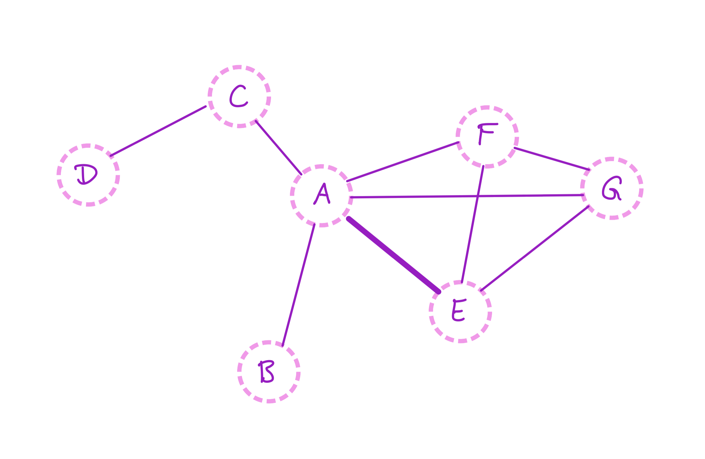
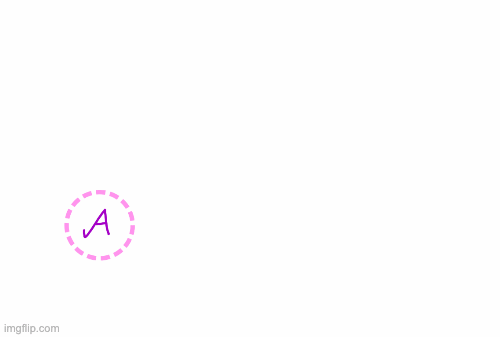
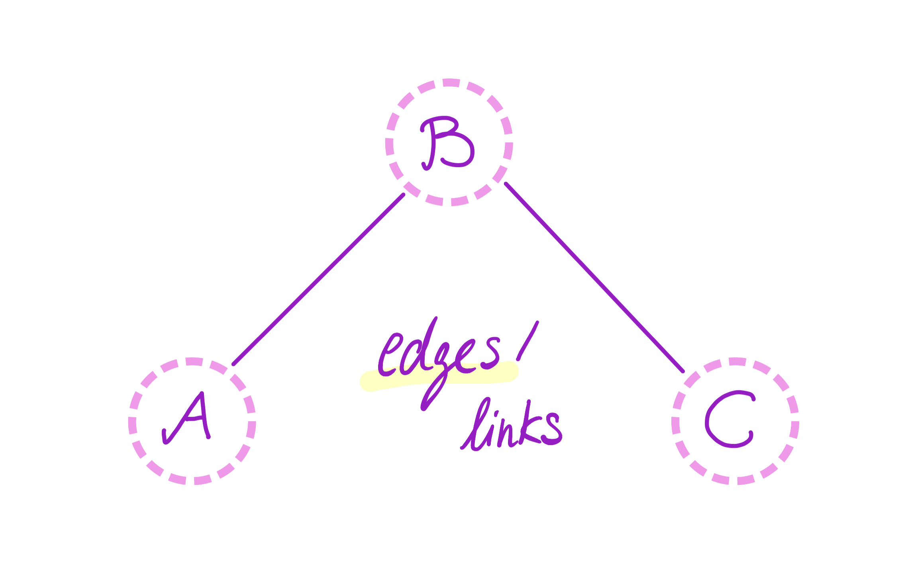
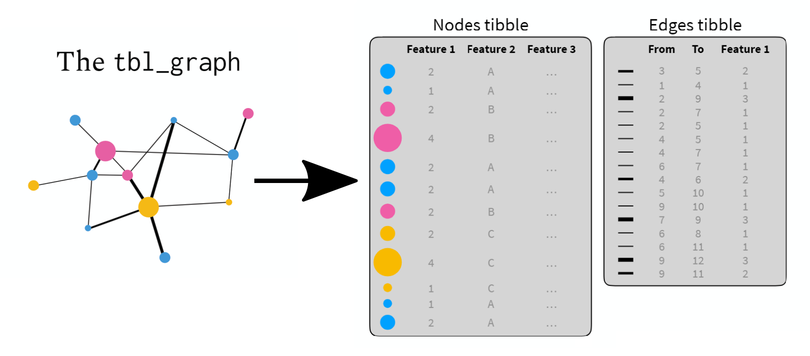
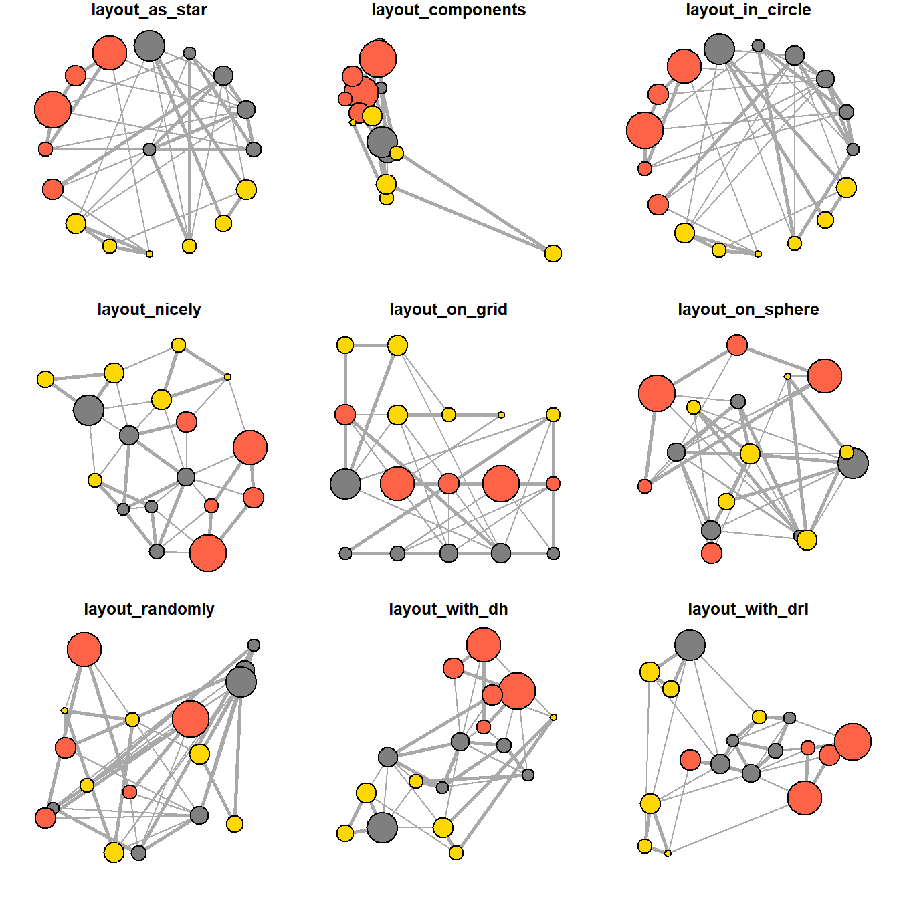

## İki farklı veri tipi

1. **Metin** → {tidytext}: bir özeti (ya da 612 özeti) tabloya çevirmek
2. **Ağ** → {tidygraph}: protein etkileşimlerini grafiğe çevirmek
3. **Metinden ağa**: ikisini birleştirmek

Ortak fikir: veriyi **tidy** formata çevir, **dplyr** fiilleriyle veriyi işle, birbirine eklenen parçalar şeklinde analiz.

::: footer
[Kaynak](https://r4ds.hadley.nz/intro.html)
:::

## Neden bu iki konu?

Biyolojik veri iki biçimde gelir:

- **Ölçüm**: tablo halinde sayılar (önceki derslerde kullandığımız `unvotes`,`gapminder` verileri)
- **İlişki**: "A, B ile etkileşiyor" (protein–protein etkileşim ağı, metabolik ağ, sitogenetik harita)

Bugün iki **gerçek** veri setiyle çalışacağız:

| Veri | Ne? | Boyut |
|---|---|---|
| PubMed özetleri | EGFR + akciğer kanseri literatürü | 612 özet (2015–2026) |
| İnsan PPI ağı | protein–protein etkileşimleri | 544.494 etkileşim, 19.162 protein |

::: footer
[Kaynak](https://www.ncbi.nlm.nih.gov/books/NBK25501/)
:::

## Eski ders notları

tidytext hakkında eski ders notları: [link](ders-tidytext.qmd)

tidygraph hakkında eski ders notları: [link](ders-tidygraph.qmd)

## Bölüm 1: Metin

{tidytext} ile metni tabloya çeviriyoruz.

Bir metin aslında bir **kelime torbası**. {tidytext} bunu "bir satır = bir (belge, kelime)" tablosuna çevirir.

```{r}
library(dplyr); library(tidytext); library(stringr); library(ggplot2)
library(purrr); library(tidyr); library(forcats)

sample_text <- "EGFR mutations drive non-small cell lung cancer."
```

```{r}
#| output-location: slide
tidy_text <- tibble(line = 1, text = sample_text) |>
  unnest_tokens(word, text)

tidy_text
```

Metin verisi de tıpkı tablo verisi gibi **tidy**: her satır tek bir gözlem.

::: footer
[Kaynak](https://www.tidytext.org/)
:::

## Kelimeleri temizlemek

Her metinde aynı "gürültü" kelimeleri var: *the, and, of, in*...

{tidytext} bir **stop words** sözlüğü ile gelir; `anti_join()` ile atarız.

```{webr}
#| cache: true
library(dplyr)
library(tidytext)

metin <- tibble(line = 1:3, text = c(
  "The patients with EGFR mutation were treated with osimertinib.",
  "Resistance to osimertinib was observed in lung cancer patients.",
  "EGFR mutation status was tested in the lung adenocarcinoma."
))

metin |>
  unnest_tokens(word, text) |>
  anti_join(stop_words, by = "word") |>
  count(word, sort = TRUE)
```

`anti_join()` = "bu sözlükteki kelimeleri at".

::: footer
[Kaynak](https://juliaconstantinou.com/2016/10/26/tidytext/)
:::

## Örnek veri: makale özetleri

Özetleri PubMed'den indirdik. İndirme kodu `data/fetch_pubmed.R` dosyasında:

```{r}
#| eval: false
base_query <- 'EGFR[tiab] AND lung[tiab]'
years      <- 2015:2026
per_year   <- 60

pmids <- map(years, function(y) {
  url <- paste0("https://eutils.ncbi.nlm.nih.gov/entrez/eutils/esearch.fcgi",
                "?db=pubmed&retmode=json&retmax=", per_year,
                "&term=", URLencode(paste0(base_query, " AND ", y, "[dp]")))
  fromJSON(url)$esearchresult$idlist
})
```

Sonra `efetch` ile özet metinleri indirilir, `map_dfr()` ile tabloya çevrilir.

::: footer
[Kaynak](https://www.ncbi.nlm.nih.gov/books/NBK25501/)
:::

## Korpusumuzu tanıyalım

```{r}
library(readr)
pubmed_data_url <- "https://raw.githubusercontent.com/alperyilmaz/mbg4181/refs/heads/master/data/pubmed_egfr.csv"
corpus <- read_csv(pubmed_data_url, show_col_types = FALSE) |>
  mutate(year = as.integer(year))

corpus
```

Beş sütun: `pmid`, `year`, `journal`, `title`, `abstract`.

## Korpusumuzu tanıyalım

```{r}
#| fig-width: 9
#| fig-height: 4.2
#| output-location: slide
corpus |>
  count(year) |>
  ggplot(aes(factor(year), n)) +
  geom_col(fill = "#2c7fb8") +
  labs(x = NULL, y = "Özet sayısı") +
  theme_classic(base_size = 13) +
  theme(axis.text.x = element_text(angle = 45, hjust = 1))
```

Her yıl en fazla 60 özet: yıllar arası karşılaştırma **dengeli** bir veriyle yapılsın diye.

::: footer
[Kaynak](https://www.ncbi.nlm.nih.gov/books/NBK25501/)
:::

## En sık kelimeler

```{r}
tokens <- corpus |>
  unnest_tokens(word, abstract) |>
  anti_join(stop_words, by = "word")

tokens |>
  count(word, sort = TRUE) |>
  slice_head(n = 10)
```

## En sık kelimeler

```{r}
#| fig-width: 7.5
#| fig-height: 5.5
#| output-location: slide
tokens |>
  count(word, sort = TRUE) |>
  slice_head(n = 15) |>
  ggplot(aes(fct_reorder(word, n), n)) +
  geom_col(fill = "#2c7fb8") +
  coord_flip() +
  labs(x = NULL, y = "Özetlerde geçen sayı") +
  theme_classic(base_size = 13)
```

`egfr`, `lung`, `cancer` ... korpusun konusu burada çıkıyor.

## Kavramların yıllara göre sayımı

**Hangi terim yıllara göre ne kadar sık kullanıldı?** sorusu tidy formattaki veri ile kolayca hesaplanabilir.

Aradığımız kelimeleri bir **tablo**ya yazıp metni **kelimelere** bölelim; ikisini `join` ile eşleştirelim.


```{r}
# Terim tablosu: aradığımız kelimeler
terms_tbl <- tibble(term = terms <- c("osimertinib", "gefitinib", 
             "erlotinib", "immunotherapy", "ctdna")) 
trend <- corpus |>
  unnest_tokens(term, abstract) |>
  inner_join(terms_tbl, by = "term") |>
  distinct(pmid, year, term) |>
  count(year, term, name = "n")

trend
```

## Trend grafiği

```{r}
#| fig-width: 9
#| fig-height: 4.8
#| output-location: slide
trend |>
  ggplot(aes(year, n, color = term)) +
  geom_line(linewidth = 0.9) +
  geom_point(size = 1.2) +
  scale_x_continuous(breaks = sort(unique(corpus$year))) +
  labs(x = NULL, y = "Özetlerin sayısı", color = NULL) +
  theme_classic(base_size = 13) +
  theme(legend.position = "bottom")
```

Osimertinib yükseliyor.


## İki kelime birlikte: bigram

Tek kelime yetmez: **"lung cancer"**, **"EGFR mutation"**, **"tyrosine kinase"** gibi ifadeler birlikte anlamlıdır.

```{r}
#| output-location: slide
bigrams <- corpus |>
  unnest_tokens(bigram, abstract, token = "ngrams", n = 2) |>
  separate_wider_delim(bigram, delim = " ", names = c("word1", "word2")) |>
  anti_join(stop_words, by = c("word1" = "word")) |>
  anti_join(stop_words, by = c("word2" = "word")) |>
  filter(!is.na(word1), !is.na(word2)) |>
  count(word1, word2, sort = TRUE)

bigrams |> slice_head(n = 10)
```

`anti_join()` ile *stop_words* temizliği yapamayız, ikili kelimelerin iki ayrı kolona ayrılması (*separate_*) daha sonra her iki kolondaki *stop_words* ayrı ayrı temizlenmesi gerekmektedir..

## TF-IDF: ayırt edici kelimeler

- **tf**: kelime bir belgede ne kadar sık
- **idf**: kelime tüm belgelerde ne kadar **nadir**

$$idf(\text{terim}) = \ln{\left(\frac{n_{\text{belge}}}{n_{\text{terimi içeren belge}}}\right)}$$

```{r}
#| eval: true
corpus |>
   unnest_tokens(word, abstract) |>
   count(pmid, word) |>
   bind_tf_idf(pmid, word, n) |> 
   filter(n>3) |> 
   arrange(-tf_idf) 
```

::: {.callout-warning}
## Gerçek hayatta gürültü olur

tf-idf **nadir** kelimeleri öne çıkarır; küçük veri kümelerinde bu "nadir" kelimeler bazen yazar adı ya da kısaltma olur. Bu yüzden filtreleme (`n >= 3`) gerekebilir.
:::

## Bölüm 2: Ağ

{tidygraph} ile ilişkileri grafiğe çeviriyoruz.

### Ağ nedir?

- **Düğüm (node)**: bir nesne (protein, gen, kelime)
- **Kenar (edge)**: iki düğüm arasındaki ilişki



::: footer
[Kaynak](https://www.ebi.ac.uk/training/online/courses/network-analysis-of-protein-interaction-data-an-introduction/introduction-to-graph-theory/graph-theory-graph-types-and-edge-properties/)
:::

## Düğüm ve kenar

Soldaki iki düğüm arasına, sağdaki gibi bir **kenar** (bağ) çizilir.

:::: {.columns}
::: {.column width="50%"}
{height="280"}
:::
::: {.column width="50%"}
{height="280"}
:::
::::

---

## Tidy graph: iki tablo

{tidygraph} bir grafiği **iki tablo** ile tutar: düğümler ve kenarlar. İkisi de {dplyr} fiilleriyle işlenir.



::: footer
[Kaynak](https://bookdown.org/wangminjie/R4DS/eda-tidygraph.html)
:::

## Mini örnek: arkadaşlık ağı

Küçük bir ağla başlayalım (arkadaşlık = yönsüz).

```{r}
friends <- tibble(
  person1 = c("alice", "charles", "david", "bob", "fiona",
               "gary", "bob", "alice", "david"),
  person2 = c("bob", "bob", "bob", "allen", "bob",
               "bob", "henry", "allen", "fiona")
)
friends
```

## Arkadaşlık ağı grafiği

```{r}
library(tidygraph)
friends_g <- friends |> as_tbl_graph(directed = FALSE)

friends_g
```

## Ağı görselleştirmek

{ggraph} = {ggplot} mantığı, ama `x`/`y` yerine **düğüm** ve **kenar** bilgisi.

```{r}
#| fig-width: 8
#| fig-height: 5
#| output-location: slide
library(ggraph)
friends_g |>
  ggraph(layout = "kk") +
  geom_edge_link() +
  geom_node_point(aes(size = centrality_degree()), color = "#de2d26") +
  geom_node_label(aes(label = name), repel = TRUE) +
  theme_graph()
```

## Derece (degree)

Bir düğümün kaç **kenarı** var? (Yönsüz ağda "kaç kişiyle bağlantılı")

```{r}
friends_g |>
  mutate(deg = centrality_degree()) |>
  as_tibble() |>
  arrange(-deg)
```

**Yönlü** ağda ayrım önemlidir:

## Yönlü ağda derece

Arkadaşlık ağını "yönlü" olarak oluşturup içe doğru, dışa doğru ve toplam derece sayımı yapalım

```{r}
friends |> 
  as_tbl_graph(directed = TRUE) |>
  mutate(
    in_deg  = centrality_degree(mode = "in"),
    out_deg = centrality_degree(mode = "out"),
    all_deg = centrality_degree(mode = "all")
  )
```

## Örnek veri: PPI ağı

Protein-protein etkileşim ağları biyolojide önemli bir veri tipidir.
```{r}
ppi_url <- "https://raw.githubusercontent.com/alperyilmaz/mbg4181/refs/heads/master/data/human_ppi.tsv.gz"
ppi <- read_tsv(ppi_url, show_col_types = FALSE)

ppi |> slice_head(n = 5)
```

İki sütun: `interactor_A`, `interactor_B`. Kısaltılmış protein adları (UniProt/S_HUMAN). Tablo **19.162 protein / 544.494 etkileşim**: çok büyük, bu yüzden sonraki adımlarda alt küme alacağız.

::: footer
[Kaynak](https://www.ebi.ac.uk/training/online/courses/network-analysis-of-protein-interaction-data-an-introduction/)
:::

## Protein-protein etkileşim verileri

Aşağıdaki veritabanlarından protein-protein etkileşim verileri elde edilebilir (Halka açık veritabanlarında genelde *Download* kısmında, veritabanındaki tüm veri csv formatında paylaşılır)

* STRING (string-db.org): 12.000'den fazla organizmadaki bilinen ve tahmin edilen protein etkileşimlerini (fiziksel bağlanma ve işlevsel yolaklar) kapsar.
* BioGRID (thebiogrid.org): Başlıca model organizmalar ve insan literatüründen derlenen kapsamlı protein, genetik ve kimyasal etkileşimleri içeren biyomedikal bir depodur.
* IntAct (ebi.ac.uk/intact): EMBL-EBI tarafından yönetilen, literatürdeki deneysel verilerin manuel olarak düzenlendiği ücretsiz ve açık kaynaklı bir moleküler etkileşim veritabanıdır.

## Tablodan ağa (grafiğe)

`as_tbl_graph` komutu, bir tabloyu ağ yapısına çevirir, iki tablo halinde, **düğüm + kenar**, saklar.


```{r}
ppi_g <- ppi |> as_tbl_graph(directed = FALSE)

ppi_g
```
## Düğüm ve kenar tabloları

Aksi belirtilmedikçe, aktif olan tablo düğüm tablosudur, kenar tablosu üzerinde, select, filter, mutate, join uygulanacak ise, `activate(edges)` kullanılmalıdır

```{r}
ppi_g |>
  activate(edges)
```

## Ağın hub genleri

Derecesi en yüksek proteinler ağın **hub**'larıdır.

```{r}
deg_tbl <- ppi_g |>
  activate(nodes) |>
  mutate(deg = centrality_degree()) |>
  as_tibble() |>
  arrange(-deg)

deg_tbl |> slice_head(n = 8)
```


## Hub genleri grafiği

```{r}
#| fig-width: 8
#| fig-height: 5
#| output-location: slide
ppi_g |>
      activate(nodes) |>
      mutate(deg = centrality_degree()) |>
      filter(deg >= 1500) |>
      ggraph(layout = "kk") +
      geom_edge_link(colour = "grey75") +
      geom_node_point(aes(size = deg), colour = "#de2d26") +
      scale_size_area(max_size = 11) +
      geom_node_label(aes(label = name), repel = TRUE, size = 3.4,
                      segment.colour = "grey60", fill = "white") +
      theme_graph()
```

## Merkezilik: betweenness

 Derece "çok kapısı var" demektir. **Betweenness** ise "ağın *ortasında* mı?": en kısa yolların kaçından geçiyor.

```{r}
ppi_g |>
     mutate(deg = centrality_degree()) |>
     filter(deg > 500) |>
     mutate(betw=centrality_betweenness())
```


## Düzen (layout)

Ağın *şekli* veriden gelmez, **çizim seçiminden** gelir. En iyisi birkaçını denemektir.



::: footer
[Kaynak](https://kateto.net/network-visualization)
:::

## Bölüm 3: Metinden ağa

Aynı fikir, metin verisiyle.

---

## Bigram ağı

Bigram sayımında elimizde `word1`, `word2` ve bir **sayı** var. Bu tam olarak "iki düğüm + aralarındaki kenar" demek.

```{r}
bg_top <- bigrams |> slice_head(n = 25)

bg_graph <- bg_top |> as_tbl_graph(directed = FALSE)
```

```{r}
#| fig-width: 10
#| fig-height: 6
#| output-location: slide
bg_graph |>
  ggraph(layout = "kk") +
  geom_edge_link(aes(width = n), colour = "grey55", alpha = 0.6) +
  geom_node_point(aes(size = centrality_degree()), colour = "#de2d26") +
  geom_node_label(aes(label = name), repel = TRUE, segment.colour = "grey70") +
  theme_graph()
```

`egfr` düğümü merkezde: *EGFR – TKI'lar*, *EGFR – mutasyonlar* etrafında toplanıyor.

## İki ağ, aynı gramer

| | Metin ağı | Protein ağı |
|---|---|---|
| Düğüm | kelime | protein |
| Kenar | "bu kelime şu kelimeden sonra geçti" | "bu iki protein etkileşiyor" |
| Ağırlık | kaç kez geçti | kaç etkileşim |
| Merkezilik | en çok "köprü" kuran kelime | sinyal yolunun kilit geni |

Aynı araçlar, farklı alan.

## Tidy fiiller lego gibi birleştirilebilir

Farklı paketlerin fonksiyonları tidy veri alıp tidy veri verir; bu yüzden uç uca eklenebilirler.

```{r}
#| eval: false
corpus |>                                    # veri
  unnest_tokens(word, abstract) |>          # tidytext
  anti_join(stop_words, by = "word") |>     # dplyr
  count(year, word) |>                      # dplyr
  filter(n > 5) |>                          # dplyr
  pivot_wider(names_from = word, values_from = n) |>   # tidyr
  as_tbl_graph(directed = FALSE) |>         # tidygraph
  activate(edges) |>
  mutate(betw = centrality_edge_betweenness()) |>      # tidygraph
  ggraph(layout = "kk") +                   # ggraph
  geom_node_point() +                       # ggraph
  geom_edge_link()                          # ggraph
```

## Sorular

1. `corpus` içinde **2015** yılı özetlerini alın; en sık 10 kelimeyi bulun.
2. `trend` tablosundan **2020** yılında en yüksek terimi bulun; o terimin yıllar boyunca yüzdelerini çizdirin.
3. `ppi_g` içinde **"EGFR"** düğümünü bulun; derecesini ve kaç komşusu olduğunu yazdırın.
4. `bigrams` içinden "egfr" kelimesini içeren 10 ikili kelime çıkarın.

## Özet

1. **Metin** de, **ağ** da tabloyla başlar: tidy veri + dplyr fiilleri.
2. {tidytext} metni kelime/bigram tablosuna çevirir; {tidygraph} ilişkiyi grafiğe çevirir.
3. İkisi aynı fikrin iki yüzü: **tablo → ölçüm**, **ağ → ilişki**.
4. Aynı araç zinciri farklı veriyle çalışır: **PubMed özeti** de, **PPI ağı** de.


::: footer
[Kaynak](https://www.tidytext.org/) · [Kaynak](https://www.tidygraph.org/)
:::
